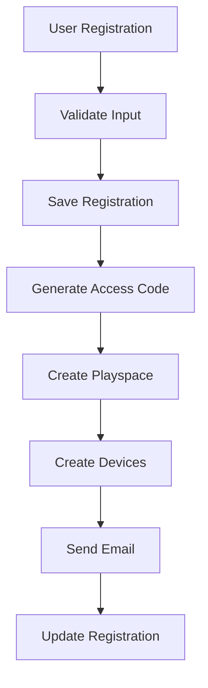
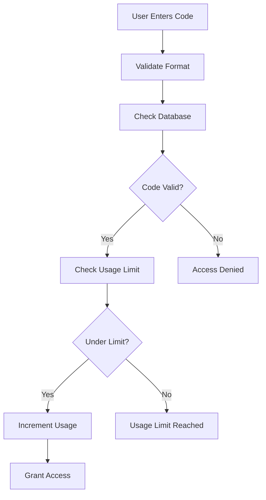

# Access Code System Implementation

## Overview

This implementation adds a comprehensive access code system to the Hack-a-Byte platform that automatically generates and emails access codes to users upon event registration. The system creates dedicated playspaces with appropriate devices based on the user's selection.

## Features

### 🎯 Core Functionality
- **Automatic Access Code Generation**: 6-digit numeric codes generated upon registration
- **Usage Limits**: Access codes work only for the specified number of players
- **Device-Specific Playspaces**: Automatically creates playspaces with appropriate devices
- **Email Delivery**: Beautiful, responsive emails with access codes and instructions
- **Resend Capability**: Ability to resend access codes if needed

### 🏗️ Architecture

#### 1. Database Models

**EventRegistration Model** (Updated)
```typescript
// Added fields:
accessCodeId?: mongoose.Schema.Types.ObjectId;
playspaceId?: mongoose.Schema.Types.ObjectId;
accessCodeSent?: boolean;
accessCodeSentAt?: Date;
```

**AccessCode Model** (Existing, Enhanced)
- Usage-limited type support
- Playspace assignment
- Usage tracking and validation

**Playspace & Device Models** (Existing)
- Automatic device creation based on selection
- Device type mapping (smartphone → HackPhone, pc_laptop → HackBook W95)

#### 2. Core Functions

**Access Code Generation** (`/lib/access-code-generation.ts`)
```typescript
createAccessCodeAndPlayspace()  // Main function
generateUniqueCode()            // 6-digit code generation
createPlayspaceWithDevices()    // Creates playspace + devices
validateAccessCodeUsage()       // Validates usage limits
```

**Email System** (`/lib/nodemailer.ts`)
```typescript
sendAccessCodeEmail()           // Sends styled access code email
```

**Event Registration** (`/app/actions/eventRegistration.ts`)
```typescript
registerForEvent()              // Updated to include access code system
resendAccessCode()             // Resend functionality
getRegistrationDetails()        // Get registration info
```

### 📧 Email Features

The access code email includes:
- **Prominent Access Code Display**: Large, styled 6-digit code
- **Device Information**: Shows selected gaming device
- **Usage Instructions**: Step-by-step guide
- **Security Warnings**: Important notes about code sharing and limits
- **Responsive Design**: Works on all devices
- **Cyber Theme**: Matches Hack-a-Byte branding

### 🔒 Security & Validation

- **Unique Code Generation**: Ensures no duplicate codes
- **Usage Limits**: Prevents unauthorized access beyond team size
- **Device Type Matching**: Ensures codes work only for intended devices
- **Playspace Isolation**: Each registration gets a dedicated environment

### 🎮 Device Integration

**Smartphone Selection** → **HackPhone Devices**
- iOS-inspired interface
- Mobile-optimized apps
- Touch-friendly controls

**PC/Laptop Selection** → **HackBook W95 Devices**
- Windows 95-inspired interface
- Desktop applications
- Mouse/keyboard interaction

## Implementation Details

### 1. Registration Flow



### 2. Access Code Usage



### 3. File Structure

```
/lib/
  ├── access-code-generation.ts    # Core access code logic
  ├── nodemailer.ts               # Email functionality (updated)
  └── test-access-code-system.ts  # Testing utilities

/models/
  ├── EventRegistration.ts        # Updated with access code fields
  ├── AccessCode.ts              # Existing, enhanced
  ├── Playspace.ts               # Existing
  └── Device.ts                  # Existing

/app/actions/
  └── eventRegistration.ts       # Updated registration logic
```

## Usage Examples

### 1. Basic Registration
```typescript
const result = await registerForEvent({
  eventId: 123,
  email: "user@example.com",
  playingDevice: "smartphone",
  numberOfPlayers: 2
});

// Returns:
// {
//   success: true,
//   message: "Successfully registered! Check your email for access code.",
//   registrationId: "...",
//   accessCode: "123456",
//   playspaceName: "Event 123 - Team 123456"
// }
```

### 2. Resending Access Code
```typescript
const result = await resendAccessCode("registrationId");
// Resends the email with access code
```

### 3. Testing the System
```typescript
import { testAccessCodeSystem } from "@/lib/test-access-code-system";

const testResult = await testAccessCodeSystem(
  "test@example.com",
  "smartphone", 
  2
);
```

## Configuration

### Environment Variables
```env
EMAIL_HOST=smtp.gmail.com
EMAIL_PORT=587
EMAIL_USER=your-email@gmail.com
EMAIL_PASS=your-app-password
EMAIL_FROM=noreply@hackabyte.com
```

### Device Configuration
The system automatically configures devices based on selection:

**HackPhone (Smartphone)**
```typescript
{
  osVersion: "iOS 16",
  installedApps: [
    "Safari", "Calculator", "Settings", 
    "Terminal", "Files", "Network Scanner", "Crypto Toolkit"
  ]
}
```

**HackBook W95 (PC/Laptop)**
```typescript
{
  osVersion: "Windows 95",
  installedApps: [
    "Notepad", "Calculator", "Paint", "MyComputer", 
    "Terminal", "Minesweeper", "CD Player"
  ]
}
```

## Error Handling

The system includes comprehensive error handling:
- **Database Connection Issues**: Graceful fallbacks
- **Email Delivery Failures**: Registration still succeeds
- **Code Generation Conflicts**: Retry mechanism
- **Usage Limit Validation**: Clear error messages

## Testing

Use the test functions to verify the system:

```typescript
// Test complete system
await testAccessCodeSystem("test@example.com", "smartphone", 2);

// Test usage limits
await testAccessCodeUsageLimit("123456");

// Test resend functionality
await testResendAccessCode("registrationId");
```

## Future Enhancements

### Planned Features
- **Code Expiration**: Time-based access code limits
- **Team Management**: Better team coordination tools
- **Analytics Dashboard**: Usage statistics and reporting
- **Custom Themes**: Personalized playspace configurations
- **Multi-Event Support**: Cross-event access codes

### Potential Improvements
- **SMS Integration**: Alternative to email delivery
- **QR Codes**: Visual access code representation
- **Social Features**: Team invitations and management
- **Progress Tracking**: Monitor team advancement
- **Leaderboards**: Competitive elements

## Support

For issues or questions about the access code system:
1. Check the error logs in the console
2. Verify environment variables are set correctly
3. Test with the provided test functions
4. Contact the development team

---

## Quick Start Checklist

- [ ] Environment variables configured
- [ ] Database models updated
- [ ] Email templates tested
- [ ] Device configurations verified
- [ ] Test functions passing
- [ ] Production deployment ready

The access code system is now ready to provide seamless, automated access to the Hack-a-Byte gaming environment!
