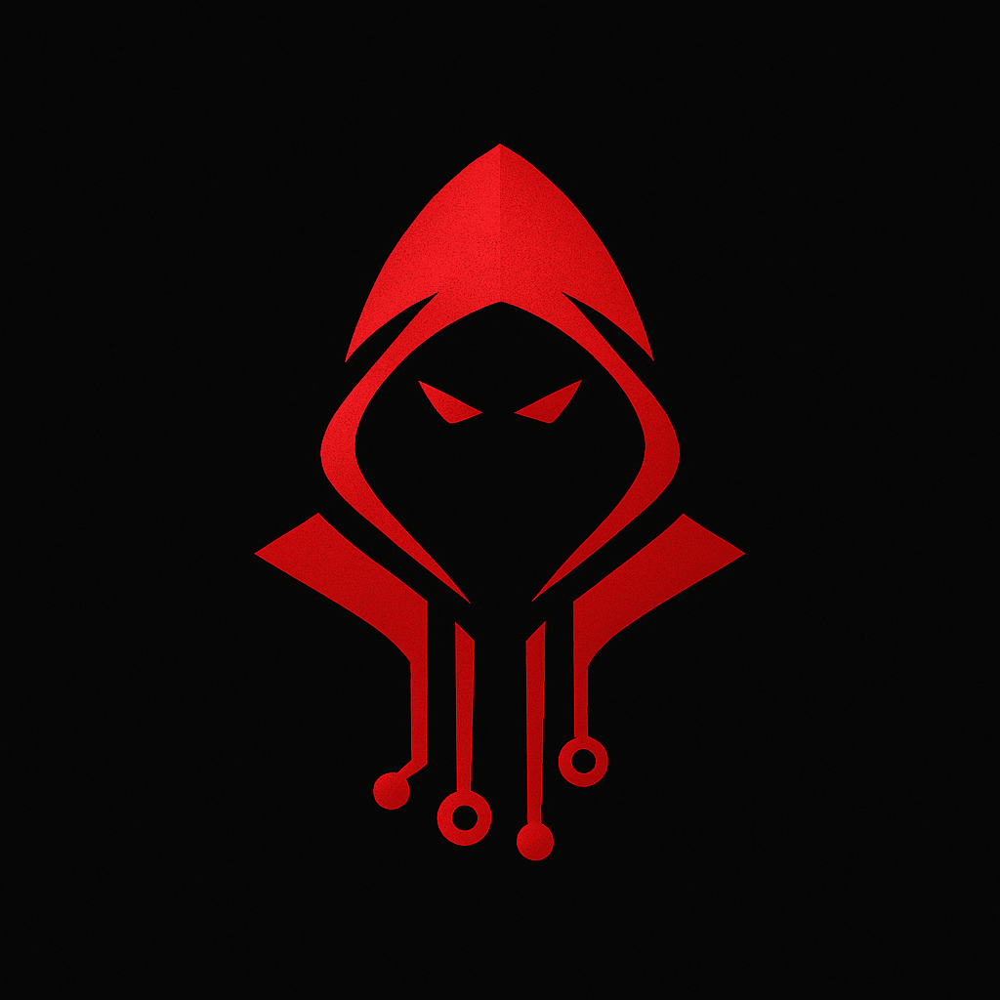

# Hack-A-Byte

A comprehensive cybersecurity education platform with interactive devices and challenges.



## Table of Contents
1. [Introduction](#1-introduction)
2. [Features](#2-features)
3. [Technical Details & Setup](#3-technical-details--setup)

## 1. Introduction

Hack-A-Byte is an interactive cybersecurity education platform that provides hands-on experience with various digital devices and security challenges.

## 2. Features

- Interactive device simulations
- Security challenges and games
- Educational content on cybersecurity
- Multi-platform support

## 3. Technical Details & Setup

### Prerequisites
- Node.js
- npm or pnpm

### Installation
```bash
pnpm install
```

### Development
```bash
pnpm dev
```

### Build
```bash
pnpm build
```
- Teams battle to accumulate the highest bitcoin balance
- Features specialized roles inspired by Money Heist characters
- Combines retro aesthetics with modern cybersecurity concepts

### Game Theme & Setting
- Set in a high-stakes cyberpunk world
- Players act as digital heist teams
- Missions involve cryptocurrency theft, defense, and strategic warfare
- Real-time PvP combat between competing teams

## 2. Gameplay Overview

### How does the game work?
- Teams register and receive unique wallet addresses and access codes
- Players enter shared devices and assign specialized roles
- Teams attack opponents while defending their own cryptocurrency
- Special "Bank Device" appears randomly for massive rewards
- Winner is the team with the highest bitcoin balance

### Game Modes
- **Team Battle:** 1-6 player teams with specialized roles
- **Solo Challenge:** Single player takes on all roles simultaneously
- **Tournament Mode:** Competitive brackets with multiple rounds
- **Quick Match:** Fast-paced 10-15 minute games

### Match Pricing & Bot System
- **Standard Match:** ₹60 per member (20-25 minutes)
- **Extended Match:** ₹100 per member (30-45 minutes)
- **AI Bot System:** Automatic opponents when player count is insufficient
- **Flexible Teams:** 1-6 players with bots filling remaining slots

### Example Gameplay Flow

#### 🔐 Team Registration & Setup
1. **Event Entry**
  - Teams scan QR code and register for the event
  - Choose platform (mobile HackDroid or desktop Windows 95/XP)
  - Pay entrance fee and receive team credentials
  - Get unique wallet address and private key via email

2. **Device Access**
  - Use access code to enter shared team device
  - Device starts in vulnerable "secureless" state
  - Assign team roles based on team size and strategy
  - Begin immediate defensive setup

3. **Role Assignment**
  - **Professor (Planner):** Strategic commander and coordinator
  - **Tokyo/Rio (Attacker):** Cyber warfare operative (2 in 6-player teams)
  - **Berlin (Defender):** System security specialist
  - **Nairobi/Denver (Extractor):** Resource acquisition specialist (2 in 6-player teams)

## 3. Team Roles & Responsibilities

### 🎯 Professor (Planner) - Strategic Commander
**Primary Mission:** Coordinate overall team strategy and resource management

**Key Responsibilities:**
- Monitor all team members and current activities
- Select target devices for Attacker operations
- Communicate threats to Defender for preparation
- Manage and instruct team members with real-time guidance
- Approve all purchases (malware, backup devices, mining software)
- Monitor team's cryptocurrency balance and game status
- Stop any ongoing attacks or extractions if situations become risky
- Make critical decision to end game early if team has sufficient currency
- Coordinate timing of all team operations for maximum efficiency

### ⚔️ Attacker (Tokyo/Rio) - Cyber Warfare Operative
**Primary Mission:** Breach enemy defenses and gain control of opponent devices

**Key Responsibilities:**
- Launch various malware attacks (viruses, trojans, ransomware)
- Purchase and deploy specialized attack tools
- Attempt to destroy enemy devices or gain temporary control
- Extract data and resources during brief control windows
- Coordinate attack timing with team strategy

**Team Scaling:** 2 Attackers allowed in 5-6 player teams

### 🛡️ Defender (Berlin) - System Security Specialist
**Primary Mission:** Protect team's cryptocurrency wallet and infrastructure

**Key Responsibilities:**
- Set and manage strong passwords for device and wallet access
- Remove unauthorized or suspicious connected users
- Configure and maintain firewalls and encryption protocols
- Connect to secure networks and maintain safe connections
- Securely store the wallet's private key in the file system
- Purchase backup devices for redundancy
- Manage device states: shutdown, restart, repair, disconnect as needed
- Actively counter malware attacks and intrusions
- Monitor system health and respond to security alerts

### 💰 Extractor (Nairobi/Denver) - Resource Acquisition Specialist
**Primary Mission:** Generate bitcoin through mining and opportunistic extraction

**Key Responsibilities:**
- Browse the internet searching for legitimate bitcoin faucets and opportunities
- Purchase and operate bitcoin mining programs and software
- Extract private keys from devices compromised by the Attacker
- Balance risk vs reward when accessing suspicious sites
- Optimize mining efficiency and resource allocation
- Coordinate with Attacker during device control windows

**Team Scaling:** 2 Extractors allowed in 5-6 player teams

## 4. Special Game Elements

### 🏦 Bank Device - High-Value Target
**The Game-Changer:** A special "Bank Device" that appears randomly during matches

**Key Features:**
- **Random Timing:** Comes online every 3-8 minutes unpredictably
- **Massive Rewards:** Contains 500-2000 bitcoin (vs 10-100 from regular targets)
- **Extreme Security:** Requires coordinated team effort to breach
- **Time Pressure:** Only available for 30-60 seconds
- **High Risk:** Failed attempts may trigger countermeasures

**Strategic Impact:**
- Teams must balance regular gameplay with bank monitoring
- Successful heists can instantly change match momentum
- Creates exciting high-stakes moments

### 🤖 AI Bot System
**Smart Opponent Matching:** When there aren't enough human players, AI bots automatically fill team slots.

**Bot Intelligence Levels:**
- **Beginner Bots:** Basic strategy, predictable patterns, good for learning
- **Intermediate Bots:** Balanced gameplay, moderate coordination, fair challenge
- **Advanced Bots:** Complex strategies, strong coordination, competitive gameplay

**Bot Integration:**
- **Seamless Experience:** Bots behave like human players with realistic decision-making
- **Role Assignment:** Bots automatically take appropriate roles based on team needs
- **Dynamic Difficulty:** Bot behavior adapts to human player skill levels
- **Fair Competition:** Bots maintain competitive balance without being unbeatable

## 5. Game Features & Mechanics

### Core Game Environment
- **Retro Operating System:** Authentic Windows 95-style desktop with nostalgic UI
- **Multi-Device Simulation:** Desktop, laptop, and mobile device interfaces
- **Advanced File System:** Complex directory structures with security protocols
- **Mission Communication Hub:** Email system for team coordination
- **Professional Terminal:** Full command-line interface with hacking tools

### Competitive Features

#### ⚔️ Real-Time PvP Combat
- **Live Attacks:** Teams actively hack each other's devices
- **Dynamic Defense:** Counter incoming threats in real-time
- **Resource Management:** Balance spending on attacks vs defense
- **Team Coordination:** Shared device forces authentic collaboration

#### 💰 Cryptocurrency System
- **Wallet Management:** Secure storage of bitcoin and private keys
- **Mining Operations:** Generate bitcoin through computational resources
- **Trading & Extraction:** Transfer crypto between teams
- **Economic Strategy:** Invest in tools, upgrades, and opportunities

#### 🎯 Tournament Integration
- **Flexible Formats:** Round robin, single elimination, Swiss system
- **Real-Time Scoring:** Live balance tracking and leaderboards
- **Spectator Mode:** Audience can watch live matches
- **Admin Controls:** Event organizers manage monitoring

### Match Structure
- **Quick Match:** 10-15 minutes for fast-paced action
- **Standard Match:** 20-25 minutes for balanced gameplay
- **Extended Match:** 30-45 minutes for strategic depth
- **Setup Phase:** 2 minutes for role assignment and planning
- **Active Phase:** Main PvP combat and resource generation
- **Resolution Phase:** 3 minutes for final scoring

## 6. Why Play CryptoHeist?

### Strategic Depth
- Multiple specialized roles with unique responsibilities
- Complex team coordination and communication challenges
- High-stakes decision making under pressure

### Competitive Excitement
- Real-time PvP combat between teams
- Random bank device creates unpredictable moments
- Tournament-style competition with meaningful stakes

### Educational Value
- Learn cybersecurity concepts through gameplay
- Understand cryptocurrency and digital security
- Practice team coordination and strategic thinking

### Flexible Gameplay
- Supports 1-6 players with balanced role distribution
- Multiple match durations for different play styles
- Cross-platform support (mobile and desktop)
- AI bot system ensures matches are always available

## 7. Tournament Structure

### Event Formats
- **Duration:** 1-2 day competitive tournaments
- **Bracket Systems:** Single elimination, double elimination, round robin
- **Match Types:** Best of 1, Best of 3, Best of 5 for finals

### Prizes & Recognition
- **Champions:** Trophy + premium cosmetics
- **Runners-up:** Trophy + exclusive skins
- **Third Place:** Bronze trophy + achievement badges
- **Special Awards:** Best Bank Heist, Most Secure Defense, Highest Score

### Tournament Features
- **Real-Time Dashboards:** Live balance tracking for all teams
- **Spectator Mode:** Audience watches team progress on big screens
- **Automated Scoring:** Transparent, real-time balance calculations
- **Team Communication:** Secure channels for strategy coordination
- **Bracket Systems:** Single elimination, double elimination, round robin
- **Match Types:** Best of 1, Best of 3, Best of 5 for finals

### Prizes & Recognition
- **Champions:** Trophy + premium cosmetics
- **Runners-up:** Trophy + exclusive skins
- **Third Place:** Bronze trophy + achievement badges
- **Special Awards:** Best Bank Heist, Most Secure Defense, Highest Score

### Tournament Features
- **Real-Time Dashboards:** Live balance tracking for all teams
- **Spectator Mode:** Audience watches team progress on big screens
- **Automated Scoring:** Transparent, real-time balance calculations
- **Team Communication:** Secure channels for strategy coordination

## 8. Technical Details & Setup

### System Requirements
**Minimum Requirements:**
- Modern web browser (Chrome, Firefox, Safari, Edge)
- Stable internet connection
- 2GB RAM
- 1GB storage space

**Recommended Requirements:**
- Latest browser version
- High-speed internet (10+ Mbps)
- 4GB+ RAM
- Modern device with touchscreen (for mobile play)

### Technology Stack
- **Frontend:** Next.js 15, React 19, TypeScript
- **Styling:** Tailwind CSS for responsive design
- **3D Graphics:** Three.js, React Three Fiber
- **Database:** MongoDB with Mongoose
- **Authentication:** JWT, bcrypt for security
- **Real-time Features:** WebSocket integration
- **Payment:** Razorpay for tournament fees

### Installation & Development

#### Prerequisites
```bash
Node.js 18+
pnpm package manager
Git
```

#### Local Development Setup
```bash
# Clone the repository
git clone <repository-url>
cd hack-a-byte

# Install dependencies
pnpm install

# Set up environment variables
cp .env.example .env.local
# Edit .env.local with your configuration

# Start development server
pnpm dev

# Build for production
pnpm build

# Start production server
pnpm start
```

#### Environment Variables
```env
NEXT_PUBLIC_BASE_URL=http://localhost:3000
MONGODB_URI=mongodb://localhost:27017/hackabyte
JWT_SECRET=your-jwt-secret
RAZORPAY_KEY_ID=your-razorpay-key
RAZORPAY_KEY_SECRET=your-razorpay-secret
```

### Project Structure
```
hack-a-byte/
├── app/                    # Next.js app router
├── components/            # React components
│   ├── hackbook-w95/     # Desktop device components
│   ├── hackphone/        # Mobile device components
│   └── games/            # Game-specific components
├── lib/                   # Utility functions and configurations
├── models/               # Database models
├── public/               # Static assets
└── event_game.md         # Complete game rules and mechanics
```

### Development Commands
```bash
pnpm dev          # Start development server
pnpm build        # Build for production
pnpm start        # Start production server
pnpm lint         # Run ESLint
pnpm type-check   # Run TypeScript type checking
```

### Deployment
The application is optimized for deployment on Vercel with:
- Automatic scaling
- Edge network distribution
- Real-time analytics integration
- Secure environment variable management

### Contributing
1. Fork the repository
2. Create a feature branch
3. Make your changes
4. Add tests if applicable
5. Submit a pull request

### Support
For technical support or questions:
- Check the event_game.md for complete game rules
- Review the component documentation
- Open an issue on GitHub

---

**CryptoHeist: Digital Warfare** delivers intense competitive gameplay with flexible team configurations, high-stakes bank heists, and authentic cybersecurity education. The random bank device mechanic adds unpredictability while maintaining strategic depth for players of all skill levels. cryptocurrency wallets. Teams of 1-6 players take on specialized roles in intense PvP combat across mobile and desktop platforms.


## Table of Contents
1. [Introduction to CryptoHeist](#1-introduction-to-cryptoheist)
2. [Gameplay Overview](#2-gameplay-overview)
3. [Team Roles & Responsibilities](#3-team-roles--responsibilities)
4. [Special Game Elements](#4-special-game-elements)
5. [Game Features & Mechanics](#5-game-features--mechanics)
6. [Why Play CryptoHeist?](#6-why-play-cryptoheist)
7. [Tournament Structure](#7-tournament-structure)
8. [Technical Details & Setup](#8-technical-details--setup)

## 1. Introduction to CryptoHeist

### What is CryptoHeist: Digital Warfare?
- A competitive PvP team-based digital heist game
- Teams battle to accumulate the highest bitcoin balance
- Features specialized roles inspired by Money Heist characters
- Combines retro aesthetics with modern cybersecurity concepts

### Game Theme & Setting
- Set in a high-stakes cyberpunk world
- Players act as digital heist teams
- Missions involve cryptocurrency theft, defense, and strategic warfare
- Real-time PvP combat between competing teams

## 2. Gameplay Overview

### How does the game work?
- Teams register and receive unique wallet addresses and access codes
- Players enter shared devices and assign specialized roles
- Teams attack opponents while defending their own cryptocurrency
- Special "Bank Device" appears randomly for massive rewards
- Winner is the team with the highest bitcoin balance

### Game Modes
- **Team Battle:** 1-6 player teams with specialized roles
- **Solo Challenge:** Single player takes on all roles simultaneously
- **Tournament Mode:** Competitive brackets with multiple rounds
- **Quick Match:** Fast-paced 10-15 minute games

### Example Gameplay Flow

#### 🔐 Team Registration & Setup
1. **Event Entry**
  - Teams scan QR code and register for the event
  - Choose platform (mobile HackDroid or desktop Windows 95/XP)
  - Pay entrance fee and receive team credentials
  - Get unique wallet address and private key via email

2. **Device Access**
  - Use access code to enter shared team device
  - Device starts in vulnerable "secureless" state
  - Assign team roles based on team size and strategy
  - Begin immediate defensive setup

3. **Role Assignment**
  - **Professor (Planner):** Strategic commander and coordinator
  - **Tokyo/Rio (Attacker):** Cyber warfare operative (2 in 6-player teams)
  - **Berlin (Defender):** System security specialist
  - **Nairobi/Denver (Extractor):** Resource acquisition specialist (2 in 6-player teams)

## 3. Team Roles & Responsibilities

### 🎯 Professor (Planner) - Strategic Commander
**Primary Mission:** Coordinate overall team strategy and resource management

**Key Responsibilities:**
- Monitor all team members and current activities
- Get details of target devices for Attacker operations
- Checks balances of wallet addressses and also transfer bitcoins.
- Can check top wallet addresses.
- info attacker when bank device is available to attack.
- invest in the stock market.
- Communicate threats to Defender for preparation
- Make critical calls to end game early if profitable

### ⚔️ Attacker (Tokyo/Rio) - Cyber Warfare Operative
**Primary Mission:** Breach enemy defenses and gain control of opponent devices

**Key Responsibilities:**
- Launch malware attacks (viruses, trojans, ransomware)
- Purchase and deploy specialized attack tools
- Attempt to destroy enemy devices or gain control or get wallet address or private keys
- Extract data during control windows
- Coordinate attack timing with team strategy

**Team Scaling:** 2 Attackers allowed in 5-6 player teams

### 🛡️ Defender (Berlin) - System Security Specialist
**Primary Mission:** Protect team's cryptocurrency wallet and infrastructure

**Key Responsibilities:**
- Set and manage strong passwords and encryption
- Remove unauthorized users and suspicious connections
- Configure firewalls and security protocols
- Securely store wallet private key
- Monitor system health and counter intrusions
- scan for malwares and tackle attacks

### 💰 Extractor (Nairobi/Denver) - Resource Acquisition Specialist
**Primary Mission:** Generate bitcoin through mining and extraction

**Key Responsibilities:**
- Browse internet for bitcoin faucets and opportunities
- Purchase and operate mining software
- Extract private keys from compromised devices
- Optimize mining efficiency and resource allocation
- Balance risk vs reward in suspicious sites

**Team Scaling:** 2 Extractors allowed in 5-6 player teams

## 4. Special Game Elements

### 🏦 Bank Device - High-Value Target
**The Game-Changer:** A special "Bank Device" that appears randomly during matches

**Key Features:**
- **Random Timing:** Comes online every 3-8 minutes unpredictably
- **Massive Rewards:** Contains 500-2000 bitcoin (vs 10-100 from regular targets)
- **Extreme Security:** Requires coordinated team effort to breach
- **Time Pressure:** Only available for 30-60 seconds
- **High Risk:** Failed attempts may trigger countermeasures

**Strategic Impact:**
- Teams must balance regular gameplay with bank monitoring
- Successful heists can instantly change match momentum
- Creates exciting high-stakes moments

## 5. Game Features & Mechanics

### Core Game Environment
- **Retro Operating System:** Authentic Windows 95-style desktop with nostalgic UI
- **Multi-Device Simulation:** Desktop, laptop, and mobile device interfaces
- **Advanced File System:** Complex directory structures with security protocols
- **Mission Communication Hub:** Email system for team coordination
- **Professional Terminal:** Full command-line interface with hacking tools

### Competitive Features

#### ⚔️ Real-Time PvP Combat
- **Live Attacks:** Teams actively hack each other's devices
- **Dynamic Defense:** Counter incoming threats in real-time
- **Resource Management:** Balance spending on attacks vs defense
- **Team Coordination:** Shared device forces authentic collaboration

#### 💰 Cryptocurrency System
- **Wallet Management:** Secure storage of bitcoin and private keys
- **Mining Operations:** Generate bitcoin through computational resources
- **Trading & Extraction:** Transfer crypto between teams
- **Economic Strategy:** Invest in tools, upgrades, and opportunities

#### 🎯 Tournament Integration
- **Flexible Formats:** Round robin, single elimination, Swiss system
- **Real-Time Scoring:** Live balance tracking and leaderboards
- **Spectator Mode:** Audience can watch live matches
- **Admin Controls:** Event organizers manage difficulty and monitoring

### Economic Strategy
- **Investment Decisions:** Choose between offensive tools and defensive upgrades
- **Risk Assessment:** Balance high-risk, high-reward opportunities
- **Resource Allocation:** Distribute bitcoin across team priorities

### Match Structure
- **Quick Match:** 10-15 minutes for fast-paced action
- **Standard Match:** 20-25 minutes for balanced gameplay
- **Extended Match:** 30-45 minutes for strategic depth 
- **Setup Phase:** 2 minutes for role assignment and planning
- **Active Phase:** Main PvP combat and resource generation
- **Resolution Phase:** 3 minutes for final scoring

## 6. Why Play CryptoHeist?

### Strategic Depth
- Multiple specialized roles with unique responsibilities
- Complex team coordination and communication challenges
- High-stakes decision making under pressure

### Competitive Excitement
- Real-time PvP combat between teams
- Random bank device creates unpredictable moments
- Tournament-style competition with meaningful stakes

### Educational Value
- Learn cybersecurity concepts through gameplay
- Understand cryptocurrency and digital security
- Practice team coordination and strategic thinking

### Flexible Gameplay
- Supports 1-6 players with balanced role distribution
- Multiple match durations for different play styles
- Cross-platform support (mobile and desktop)

## 7. Tournament Structure

### Event Formats
- **Duration:** 1-2 day competitive tournaments
- **Bracket Systems:** Single elimination, double elimination, round robin
- **Match Types:** Best of 1, Best of 3, Best of 5 for finals

### Prizes & Recognition
- **Champions:** Trophy + premium cosmetics
- **Runners-up:** Trophy + exclusive skins
- **Third Place:** Bronze trophy + achievement badges
- **Special Awards:** Best Bank Heist, Most Secure Defense, Highest Score

### Tournament Features
- **Real-Time Dashboards:** Live balance tracking for all teams
- **Spectator Mode:** Audience watches team progress on big screens
- **Automated Scoring:** Transparent, real-time balance calculations
- **Team Communication:** Secure channels for strategy coordination

## 8. Technical Details & Setup

### System Requirements
**Minimum Requirements:**
- Modern web browser (Chrome, Firefox, Safari, Edge)
- Stable internet connection
- 2GB RAM
- 1GB storage space

**Recommended Requirements:**
- Latest browser version
- High-speed internet (10+ Mbps)
- 4GB+ RAM
- Modern device with touchscreen (for mobile play)

### Technology Stack
- **Frontend:** Next.js 15, React 19, TypeScript
- **Styling:** Tailwind CSS for responsive design
- **3D Graphics:** Three.js, React Three Fiber
- **Database:** MongoDB with Mongoose
- **Authentication:** JWT, bcrypt for security
- **Real-time Features:** WebSocket integration
- **Payment:** Razorpay for tournament fees

### Installation & Development

#### Prerequisites
```bash
Node.js 18+
pnpm package manager
Git
```

#### Local Development Setup
```bash
# Clone the repository
git clone <repository-url>
cd hack-a-byte

# Install dependencies
pnpm install

# Set up environment variables
cp .env.example .env.local
# Edit .env.local with your configuration

# Start development server
pnpm dev

# Build for production
pnpm build

# Start production server
pnpm start
```

#### Environment Variables
```env
NEXT_PUBLIC_BASE_URL=http://localhost:3000
MONGODB_URI=mongodb://localhost:27017/hackabyte
JWT_SECRET=your-jwt-secret
RAZORPAY_KEY_ID=your-razorpay-key
RAZORPAY_KEY_SECRET=your-razorpay-secret
```

### Project Structure
```
hack-a-byte/
├── app/                    # Next.js app router
├── components/            # React components
│   ├── hackbook-w95/     # Desktop device components
│   ├── hackphone/        # Mobile device components
│   └── games/            # Game-specific components
├── lib/                   # Utility functions and configurations
├── models/               # Database models
├── public/               # Static assets
└── event_game.md         # Complete game rules and mechanics
```

### Development Commands
```bash
pnpm dev          # Start development server
pnpm build        # Build for production
pnpm start        # Start production server
pnpm lint         # Run ESLint
pnpm type-check   # Run TypeScript type checking
```

### Deployment
The application is optimized for deployment on Vercel with:
- Automatic scaling
- Edge network distribution
- Real-time analytics integration
- Secure environment variable management

### Contributing
1. Fork the repository
2. Create a feature branch
3. Make your changes
4. Add tests if applicable
5. Submit a pull request

### Support
For technical support or questions:
- Check the event_game.md for complete game rules
- Review the component documentation
- Open an issue on GitHub

---

**CryptoHeist: Digital Warfare** delivers intense competitive gameplay with flexible team configurations, high-stakes bank heists, and authentic cybersecurity education. The random bank device mechanic adds unpredictability while maintaining strategic depth for players of all skill levels.

## 6. Why Play CryptoHeist?

### Strategic Depth
- Multiple specialized roles with unique responsibilities
- Complex team coordination and communication challenges
- High-stakes decision making under pressure

### Competitive Excitement
- Real-time PvP combat between teams
- Random bank device creates unpredictable moments
- Tournament-style competition with meaningful stakes

### Educational Value
- Learn cybersecurity concepts through gameplay
- Understand cryptocurrency and digital security
- Practice team coordination and strategic thinking

### Flexible Gameplay
- Supports 1-6 players with balanced role distribution
- Multiple match durations for different play styles
- Cross-platform support (mobile and desktop)

## 7. Tournament Structure

### Event Formats
- **Duration:** 1-2 day competitive tournaments
- **Bracket Systems:** Single elimination, double elimination, round robin
- **Match Types:** Best of 1, Best of 3, Best of 5 for finals

### Prizes & Recognition
- **Champions:** Trophy + premium cosmetics
- **Runners-up:** Trophy + exclusive skins
- **Third Place:** Bronze trophy + achievement badges
- **Special Awards:** Best Bank Heist, Most Secure Defense, Highest Score

### Tournament Features
- **Real-Time Dashboards:** Live balance tracking for all teams
- **Spectator Mode:** Audience watches team progress on big screens
- **Automated Scoring:** Transparent, real-time balance calculations
- **Team Communication:** Secure channels for strategy coordination

## 8. Technical Details & Setup

### System Requirements
**Minimum Requirements:**
- Modern web browser (Chrome, Firefox, Safari, Edge)
- Stable internet connection
- 2GB RAM
- 1GB storage space

**Recommended Requirements:**
- Latest browser version
- High-speed internet (10+ Mbps)
- 4GB+ RAM
- Modern device with touchscreen (for mobile play)

### Technology Stack
- **Frontend:** Next.js 15, React 19, TypeScript
- **Styling:** Tailwind CSS for responsive design
- **3D Graphics:** Three.js, React Three Fiber
- **Database:** MongoDB with Mongoose
- **Authentication:** JWT, bcrypt for security
- **Real-time Features:** WebSocket integration
- **Payment:** Razorpay for tournament fees

### Installation & Development

#### Prerequisites
```bash
Node.js 18+
pnpm package manager
Git
```

#### Local Development Setup
```bash
# Clone the repository
git clone <repository-url>
cd hack-a-byte

# Install dependencies
pnpm install

# Set up environment variables
cp .env.example .env.local
# Edit .env.local with your configuration

# Start development server
pnpm dev

# Build for production
pnpm build

# Start production server
pnpm start
```

#### Environment Variables
```env
NEXT_PUBLIC_BASE_URL=http://localhost:3000
MONGODB_URI=mongodb://localhost:27017/hackabyte
JWT_SECRET=your-jwt-secret
RAZORPAY_KEY_ID=your-razorpay-key
RAZORPAY_KEY_SECRET=your-razorpay-secret
```

### Project Structure
```
hack-a-byte/
├── app/                    # Next.js app router
├── components/            # React components
│   ├── hackbook-w95/     # Desktop device components
│   ├── hackphone/        # Mobile device components
│   └── games/            # Game-specific components
├── lib/                   # Utility functions and configurations
├── models/               # Database models
├── public/               # Static assets
└── event_game.md         # Complete game rules and mechanics
```

### Development Commands
```bash
pnpm dev          # Start development server
pnpm build        # Build for production
pnpm start        # Start production server
pnpm lint         # Run ESLint
pnpm type-check   # Run TypeScript type checking
```

### Deployment
The application is optimized for deployment on Vercel with:
- Automatic scaling
- Edge network distribution
- Real-time analytics integration
- Secure environment variable management

### Contributing
1. Fork the repository
2. Create a feature branch
3. Make your changes
4. Add tests if applicable
5. Submit a pull request

### Support
For technical support or questions:
- Check the event_game.md for complete game rules
- Review the component documentation
- Open an issue on GitHub

---

**CryptoHeist: Digital Warfare** delivers intense competitive gameplay with flexible team configurations, high-stakes bank heists, and authentic cybersecurity education. The random bank device mechanic adds unpredictability while maintaining strategic depth for players of all skill levels.

2. **Environment Initialization**
  - Customize your hacker alias and profile
  - Receive starter tools and basic system access
  - Tutorial walkthrough of the interface and controls

#### 💰 Digital Economy & Crypto Banking
1. **Wallet Creation & Management**
  - Apply for a secure cryptocurrency wallet through the in-game banking system
  - Receive your unique wallet credentials:
    - **Public Key**: Your wallet address for receiving transactions
    - **Private Key**: Secure authentication for wallet access (keep safe!)
  
2. **Earning & Trading Cryptocurrencies**
  - **Mining Operations**: Use computational resources to mine virtual crypto
  - **Mission Rewards**: Complete hacking challenges to earn digital currency
  - **Trading**: Exchange currencies with other players in the marketplace
  - **Transfers**: Send and receive crypto between players securely

3. **Economic Progression**
  - Purchase advanced hacking tools and exploits
  - Upgrade virtual hardware and software capabilities
  - Invest in premium missions with higher risk/reward ratios

## 3. Team-Based Competitive Events

### Event Structure
- Teams compete in structured tournaments
- Winners determined by highest cryptocurrency balance
- Multiple rounds with escalating difficulty
- Real-time leaderboards showing team rankings

### Competitive Game Modes

#### 🏆 Crypto Rush Tournament
- **Objective**: Accumulate the highest crypto balance within time limits
- **Format**: Multiple rounds, elimination-style or point-based
- **Activities**: Mining challenges, security exploits, trading competitions
- **Duration**: 2-6 hours depending on event scale

#### 💻 System Infiltration Challenge
- **Goal**: Breach target systems to access hidden crypto wallets
- **Team Play**: Coordinate attacks, share intelligence, divide tasks
- **Scoring**: Crypto earned per successful infiltration
- **Difficulty**: Progressive security measures as teams advance

#### 🔐 Crypto Heist Simulation
- **Mission**: Plan and execute coordinated digital heists
- **Strategy**: Teams must overcome multi-layered security systems
- **Rewards**: Major crypto payouts for successful heists
- **Risk**: Failed attempts result in balance penalties

#### 🛡️ Defense & Counter-Attack
- **Dual Role**: Protect your crypto while attacking opponents
- **Team Coordination**: Assign defenders and attackers strategically
- **Balance Shifts**: Successful attacks transfer crypto between teams
- **Victory**: Last team standing with positive balance

### Event Management Features
- **Real-time Dashboards**: Live crypto balance tracking for all teams
- **Admin Controls**: Event organizers can adjust difficulty and monitor progress
- **Spectator Mode**: Audience can watch team progress on big screens
- **Automated Scoring**: Transparent, real-time balance calculations
- **Team Communication**: Secure channels for strategy coordination

### Tournament Formats
- **Sprint Events**: 1-2 hour quick competitions
- **Marathon Sessions**: Full-day tournaments with breaks
- **League Play**: Multi-week competitions with scheduled matches
- **Knockout Tournaments**: Single-elimination bracket style

## 4. Game Features & Mechanics

### Core Game Environment
- **Retro Operating System**: Authentic Windows 95-style desktop environment with nostalgic UI elements
- **Multi-Device Simulation**: Seamlessly switch between desktop, laptop, and mobile device interfaces
- **Advanced File System**: Navigate complex directory structures with hidden files, encrypted data, and security protocols
- **Mission Communication Hub**: Integrated email system for receiving briefings, intel, and coordinating operations
- **Professional Terminal**: Full-featured command-line interface with authentic hacking tools and utilities

## 5. Why Play Hack A Byte?

### Educational Value
- Learn real cybersecurity concepts in a fun, interactive way
- Safe environment to practice ethical hacking techniques

### High Replayability
- Different hacking approaches lead to different outcomes
- Multiple game modes and challenges

### Competitive Leaderboards
- Compare hacking skills with players worldwide
- Track progress and achievements

### Futuristic Aesthetic
- Cyberpunk-inspired visuals
- Immersive hacking experience

## 6. Screenshots & Visuals
*Coming soon: High-quality screenshots showing:*
- Hacking interfaces
- In-game missions
- Successful exploits
- Leaderboards & rankings

## 7. Technical Details & Setup

### System Requirements

#### Prerequisites
- **Node.js**: Version 18.0 or higher ([Download](https://nodejs.org/))
- **Package Manager**: npm (included with Node.js) or yarn
- **Web Browser**: Modern browser with JavaScript enabled
  - Chrome 90+, Firefox 88+, Safari 14+, Edge 90+

#### Hardware Recommendations
- **RAM**: Minimum 4GB, recommended 8GB for optimal performance
- **Storage**: At least 500MB free space for installation
- **Network**: Stable internet connection for multiplayer features

#### Development Environment (Optional)
- **Git**: For version control and repository cloning
- **Code Editor**: VS Code, WebStorm, or similar for customization
- **MongoDB**: Local instance or cloud service for database functionality

### Installation

1. Clone the repository:
```bash
git clone https://github.com/Dhaval-Suthar/Hack-a-Byte.git
cd hack-a-byte
```

2. Install dependencies:
```bash
npm install
# or
yarn install
```

3. Set up environment variables:
```bash
cp .env.example .env.local
```
Edit `.env.local` with your configuration.

4. Run the development server:
```bash
npm run dev
# or
yarn dev
```

5. Open [http://localhost:3000](http://localhost:3000) in your browser.

### Built With
- [Next.js](https://nextjs.org/) - React framework
- [Tailwind CSS](https://tailwindcss.com/) - Styling
- [Framer Motion](https://www.framer.com/motion/) - Animations
- [TypeScript](https://www.typescriptlang.org/) - Type safety
- [MongoDB](https://www.mongodb.com/) - Database

## Admin Authentication

The admin panel uses file upload authentication for secure access. See [FILE_UPLOAD_AUTH.md](./FILE_UPLOAD_AUTH.md) for detailed instructions.

**Quick Start for Admins:**
1. Navigate to `/admin`
2. Upload the authentication key file (`admin-key.txt`)
3. Access the comprehensive admin dashboard

## 🔒 Security Notice

Hack A Byte is designed as an educational tool to learn cybersecurity concepts in a safe environment. All hacking activities are simulated and contained within the game's virtual environment.

## 📝 License

This project is licensed under the MIT License - see the [LICENSE](LICENSE) file for details.

## 🤝 Contributing

Contributions are welcome! Please feel free to submit a Pull Request.

1. Fork the repository
2. Create your feature branch (`git checkout -b feature/AmazingFeature`)
3. Commit your changes (`git commit -m 'Add some AmazingFeature'`)
4. Push to the branch (`git push origin feature/AmazingFeature`)
5. Open a Pull Request

## 📧 Contact

For any questions or suggestions, please open an issue in the repository.

---

Made with ❤️ by the Hack-A-Byte team
